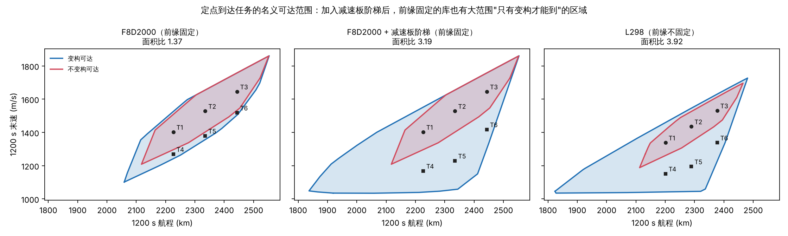
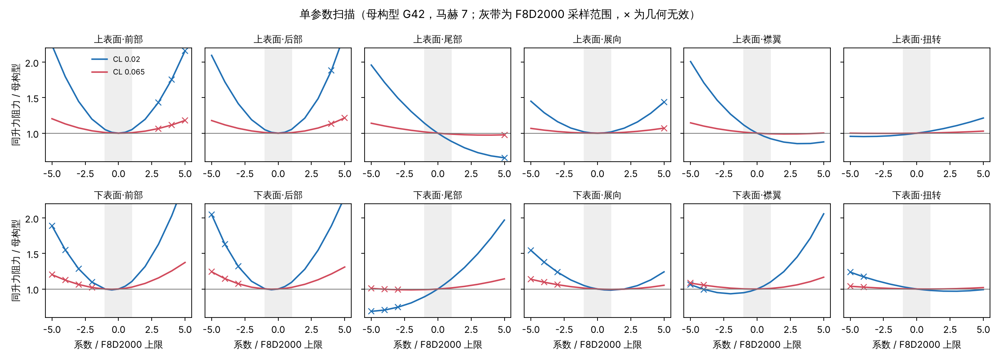
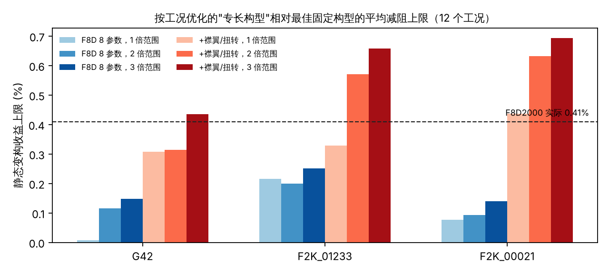
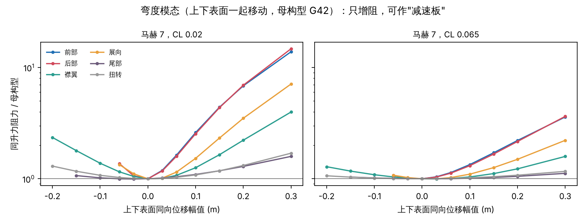

# 前缘不变时，怎样建构型库才能让变构收益变大

本研究在老师唯一的要求"前缘不变（固定 G42 三维前缘）"下，回答怎样建构型库才能让变构收益变大。
所有气动都用项目原来的 P2 表面压力模型：已移植成 Python，并和 F8D2000、L298 存的气动表逐点核对，误差 10⁻¹⁵ 量级。

## 一句话结论

"变构收益"有两种，结果完全不同：

1. **静态收益**：每个工况挑阻力最小的构型，相对最佳固定构型的平均减阻。这也是原来"飞最远"任务里变构带来的收益。
   **前缘固定时它天然很小**：放宽参数范围、增加新的变形方式都突破不了，P2 下的理论上限约 **0.7%**。
   F8D2000 的 0.41% 已接近这个上限，不是库没建好。
2. **能量调节收益**：同一升力下，构型之间的阻力能差多少，也就是定点到达任务需要的收益。**这个可以做得很大。**
   只要在 F8D2000 基础上加 91 个前缘不变的"减速板"构型（上下表面一起弯曲），定点到达任务的变构收益就从
   F8D2000 的水平提高到接近前缘不固定的 L298：

| 库 | 前缘 | 构型数 | 静态收益 | 同升力阻力 最大/最小 | 定点到达：变构可达区域 / 不变构 | 只有变构能到的区域宽度 |
|---|---|---|---|---|---|---|
| L298 | 不固定 | 298 | 1.20% | 4.50 | 3.92 倍 | 219～300 m/s |
| F8D2000 | 固定 | 2000 | 0.41% | 1.58 | 1.37 倍 | 29～54 m/s |
| F8D 方法、范围放大 3 倍 | 固定 | 600 | 0.00% | 3.16 | 2.92 倍 | 230～284 m/s |
| **F8D2000B = F8D2000 + 减速板阶梯** | **固定** | **2091** | **0.41%** | **3.99** | **3.19 倍** | **230～346 m/s** |

建议：论文主实验如果是定点到达任务，构型库用 **F8D2000B**，它满足老师的前缘要求，变构收益又和 L298 相当。



## 1. 两种指标的定义

- **静态收益：** 马赫 5.75～8（10 档）× 升力系数 0.015～0.070（12 档），共 120 个工况等权。
  收益 = 1 − 平均（每工况最小阻力）/ 平均（最佳固定构型阻力）。这和 F8D2000 说明里的定义相同，本研究的代码
  复现出 0.411%，与原值一致。
- **阻力调节能力：** 同一工况、同一升力系数下，库内最大阻力 / 最小阻力，取 120 个工况的平均。
- **定点到达任务：** 用 `target_rl` 在名义状态下飞"三段动压设定 × 三段变构程度"网格，比较变构和不变构时
  1200 s（航程，末速）可达区域的面积，以及"只有变构才能到"的低速窄带宽度，即 `region.json` 中 T4～T6 处的带宽。

## 2. F8D2000 的静态收益为什么小

**证据一：最佳固定构型贴着采样上限。** F8D_01351 的上表面尾部系数 0.038（上限 0.04），下表面尾部 −0.033
（上限 −0.035）。最优方向是"把尾部削薄"，在所有工况下都一样。

**证据二：收益只出现在高升力、高马赫。** 按升力系数看，0.015～0.040 的工况收益为 0，到 0.070 也只有 0.84%。
低升力时最佳固定构型本身就是每个工况的最优构型。

**证据三：单参数扫描（图 1）。** 把每个参数单独放大到原范围的 5 倍：

- 大部分参数在两个方向上都增阻，原构型就在最优点附近；
- 尾部削薄（上表面尾部 +、下表面尾部 −）在低升力系数时减阻 20～35%，在高升力系数时几乎不变或略增阻；
- 但两者一起放大时，尾缘厚度会变成负值，几何失效。



## 3. 能不能靠放宽范围或增加变形方式提高静态收益？——不能

做法是**直接求上限**：对每个母构型（G42、F2K_01233、F2K_00021），在马赫 6、7、8 × 升力系数 0.02、0.035、
0.05、0.065 共 12 个工况上：

- 每个工况单独优化出阻力最小的外形，称为"专长构型"；
- 再优化一个全工况平均阻力最小的外形，即最佳固定构型；
- 上限 = 专长构型相对最佳固定构型的平均减阻。

约束为几何有效、体积不小于 F8D2000 的最小值、P2 有效。参数范围取原范围的 1、2、3 倍，参数组分为"F8D 原 8 参数"
和"再加襟翼、扭转两种变形"，共 234 次优化。为防止个别优化没收敛，最后把找到的所有外形放在一起，重新挑最佳固定
构型和每个工况的最优构型。

| 参数组 | 1 倍范围 | 2 倍范围 | 3 倍范围 | 单个工况最高 |
|---|---|---|---|---|
| F8D 原 8 参数 | 0.01～0.22% | 0.09～0.20% | 0.14～0.25% | 1.6% |
| 加襟翼、扭转 | 0.31～0.44% | 0.31～0.63% | 0.44～0.69% | 9.7% |

（每格是三个母构型的范围。）



**原因：** 前缘和平面形状固定后，升力系数的变化主要靠攻角吸收，不同工况的最优外形几乎是同一个，都是把尾部
削薄到几何允许的极限。按工况换构型能多得的只是高升力、高马赫下的一点微调。

**作为对比：** 优化出一个好的**固定**外形，比母构型减阻 5～10%。这属于外形优化，不属于变构收益。

L298 的 1.2% 静态收益来自不同的前缘和平面形状，这正是老师不允许变的部分。

## 4. 能做大的：阻力调节能力（"减速板"构型）

把上下表面按同一位移一起移动，叫"弯度模态"，厚度分布基本不变，所以大幅度变形也不会几何失效。扫描（图 2）表明：

- 弯度模态在所有工况下**只增阻、不减阻**，所以对静态收益没有帮助；
- 但阻力增大很多（马赫 7、升力系数 0.02）：前部弯度 +0.10 m 时阻力约为原来的 2.6～3.1 倍，后部弯度 +0.15 m 时约 4.4～5.0 倍；
- 几何有效，并且在全部 18 个马赫数 × 20 个攻角的网格点上 P2 都有效。

这正是定点到达任务需要的：要多耗能时切到"减速板"构型，要保速度时用低阻构型。



## 5. 推荐的建库方法（F8D2000B）

1. **保留 F8D2000 全部 2000 个构型**，它们提供低阻和巡航效率，静态收益不变。
2. **每个母构型（G42、F2K_01233、F2K_00021）加一组"减速板阶梯"：**
   - 前部、后部、襟翼三种弯度模态（上下表面同向位移），幅值 0.02、0.04、0.06、0.08、0.10、0.13、0.16 m，以及
     −0.02、−0.04 m；
   - 尾部削薄系列：上表面尾部 +0.5～3 × 0.04 m，同时下表面尾部 −0.5～3 × 0.035 m（6 档）；
   - 加上母构型本身。
3. **筛选：** 几何有效（无折叠、厚度不为负）、体积不小于 0.4687 m³（F8D2000 的最小值）、全网格 P2 有效。
   102 个方案留下 91 个，体积 0.59～1.05 m³。
4. 所有变形的基函数在前缘列和翼尖行上为零，前缘、x/y 网格、平面形状和长度都不变（测试中逐点检查）。

生成和评估都可以复现：

```bash
PYTHONPATH=src python -m libdesign.build --design ladder
```

如果需要更细的阻力档位，可以把幅值步长加密（如 0.01 m），或组合两种模态；目前 91 个已足够让可达区域扩大到
不变构的 3.2 倍。

## 6. 对论文的影响

- **"飞最远"任务：** 在前缘固定的要求下，变构的航程收益天然很小（静态收益上限约 0.7%）。这是模型和约束决定的，
  建议在论文里如实说明，并用本研究的上限分析作为论据。
- **定点到达任务：** 用 F8D2000B，变构让可达区域扩大到 3.2 倍，"只有变构才能到"的末速范围宽 230～346 m/s，
  与 L298 相当，又满足前缘不变的要求。如果主实验改用 F8D2000B，需要在 `target-rl` 分支的预注册里追加修订 3。
- **另一个可能方向：配平。** F8D2000 的固定构型俯仰力矩随升力系数从 −0.0008 变到 −0.0048，库内构型之间的
  力矩差也是这个量级，变形可以替代舵面配平。工程里没有重心位置和舵面阻力模型，这里没有算具体收益。

## 6b. 开发筛查：经典制导在"只有变构能到"的目标上有多强

为了判断强化学习在新库上还有没有空间，用**训练场景**（1100–1105，L2 扰动；不碰预注册的测试场景）在 T4～T6 上
飞了三种基线（`python -m libdesign.dev_screen`）：

| T4～T6，6 个场景 × 3 个目标 | F8D2000B | L298 |
|---|---|---|
| 公平版预测-校正（pc_fair，预注册的主对比） | 4/18 命中，3 次超限 | 5/18 命中，2 次超限 |
| 强版预测-校正（pc_strong，分三段、每 24 s 重规划） | **16/18** | **15/18** |
| 全知参照（三段开环，Nelder-Mead 150 次） | 9/18 | 7/18 |

两点结论：

1. **强版预测-校正已经很强。** 主判据和公平版比，空间很大；但审稿人很可能要求和强版比，强版已能打中约 85%，
   强化学习要明显超过它会很难。论文的卖点可能需要落在计算量（强版每次飞行要做上百次预测）或扰动更强时的表现上。
2. **全知参照不是真正的上界。** 它只搜索 150 次，打中的反而比闭环重规划的强版少，论文中不能称为"上界"，
   要么加大搜索次数，要么只作参考。

这一结论对 L298 和 F8D2000B 相同，与构型库无关。

## 7. 局限

- P2 只有表面压力，没有摩擦和底部阻力。尾部削薄在真实流动中还会减小底部面积，影响不在模型内。
- 减速板构型的弯度最大约 0.16 m（机身长 5 m），机构能否实现、结构和热载荷都没有验证；8 s 变构过渡也没有计入。
- 定点到达任务中，变构用"同升力下最小到最大阻力之间插值"作代理，不是逐个真实构型。
- 优化上限是在 12 个工况上、每次 400 次评估得到的数值上限，真实上限可能略高，但三个母构型、两组参数、三种范围
  的结论一致。

## 8. 复现

在 `library-design` 分支上：

| 步骤 | 命令 | 输出 |
|---|---|---|
| 单参数扫描 | `PYTHONPATH=src python -m libdesign.sweep` | `runs/library_design/sweep.json` |
| 弯度模态扫描 | `PYTHONPATH=src python -m libdesign.sweep_camber` | `runs/library_design/sweep_camber.json` |
| 优化上限 | `PYTHONPATH=src python -m libdesign.optimize --sets f8d,f8d_flap --ks 1,2,3` | `runs/library_design/optimize.json` |
| 汇总上限 | `PYTHONPATH=src python -m libdesign.pooled` | `runs/library_design/pooled.json` |
| 建库 | `PYTHONPATH=src python -m libdesign.build --design ladder` | `runs/library_design/libraries/ladder.npz` |
| 定点到达可达范围 | `TARGET_RL_LIBRARY=F8D2000B PYTHONPATH=src python -m target_rl.region` | `runs/F8D2000B/region.json` |
| 画图 | `PYTHONPATH=src python -m libdesign.figures` | `docs/figures/*.png` |
| 测试 | `pytest -q` | P2 移植、生成器、前缘不变、指标 |

在 F8D2000B 上跑完整的强化学习流程：

```bash
LIBRARY=F8D2000B WORKERS=$(nproc) bash scripts/run_all.sh
```
